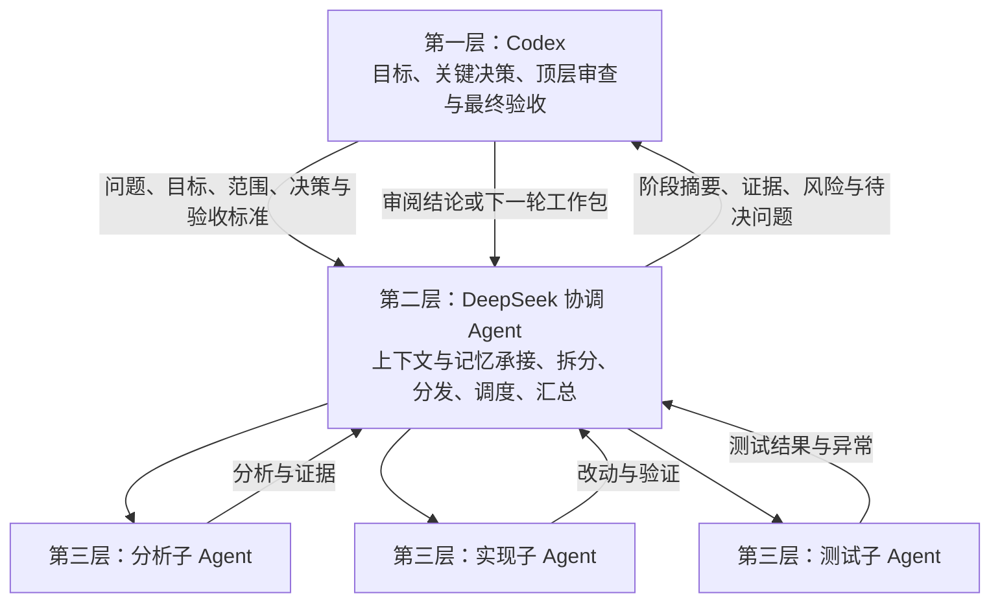

# subagent-deepseek 0.9.2

默认三层：**Codex顶层审查 → DeepSeek协调层（记忆、分发、汇总）→ 分析/实现/测试worker**。
首次使用阅读 QUICKSTART.md；完整角色协议见 THREE-LAYER-WORKFLOW.md。

## 架构



流程的完整说明、三层职责、记忆维护和回传字段见 [docs/subagent-deepseek-三层协作协议.md](docs/subagent-deepseek-三层协作协议.md)；程序接入与 12 条协作规则见 [THREE-LAYER-WORKFLOW.md](THREE-LAYER-WORKFLOW.md)。

## 安装

面向Linux，需Python3.11+、venv/pip、Codex及网络。Harness、Codex和测试浏览器不随包分发。

1. 克隆仓库或解压到永久目录，阅读安装影响后运行 `bash install.sh`。
2. 请主Agent识别并配置settings.json，或打开configurator.html填写。密钥只引用自己的私有文件，不能使用示例占位路径。
3. 合并以下MCP配置，替换实际安装路径后重载连接：

```toml
[mcp_servers.subagent_deepseek]
command = "/absolute/path/subagent-deepseek-0.9.2/.venv/bin/subagent-deepseek"
args = ["--settings", "/absolute/path/subagent-deepseek-0.9.2/settings.json"]
tool_timeout_sec = 3700
```

安装器默认备份合并用户级AGENTS.md；新示例使用codex-trust，无需工作区Hook。仅显式codex-hook模式安装Hook，旧设置与allowed_roots保留，不自动迁移。
使用可选codex-hook模式时不会代批Hook信任；首次需在Codex审阅。`DEEPSEEK_SKIP_CODEX_POLICY=1 bash install.sh`可跳过全局规则和Hook步骤。
仅安装wheel不自动修改全局文件或迁移设置。Python程序加载当前仍要求有效codex_binary和credential_file路径，即使仅使用Harness。

## 三层模式需要Harness

先运行已有Harness Web Host，在settings.json合并：

```json
{
  "harness_url": "http://127.0.0.1:3080",
  "harness_launch_log": "/absolute/path/to/harness-launch.log",
  "harness_provider": "deepseek-account"
}
```

地址仅接受本机HTTP。日志必须属于该服务并含正常启动登录URL，使用官方/connect换取私有API认证。
账号模式使用网页已有账号；deepseek-official使用Harness的官方API配置。模型固定deepseek-flash/high，不静默切换路由。
协调层需原生subagent及完成通知工具。缺少能力/触发Host深度限制时应报告受阻，不伪装成三层或偷偷切direct。

## 推荐操作

- project_board(init/read/add/update)：顶层项目规划、Bug和验收。Codex独立审查后才用新evidence标记done。
- project_dispatch：默认role=coordinator；传任务类型、范围、版本、检查和Codex决定。协调Agent创建真实原生workers。
- project_collect：刷新根会话与原生子任务状态；核验成功进入review，子任务失败/第四层/伪造ID/观测不全等记为受阻。
- project_coordination：读取DEEPSEEK_COORDINATION.md，保存阶段记忆、实际子任务父子ID及结构化报告；下一轮带入同工作包记忆。
- 同一工作包默认复用同一空闲协调会话，reuse_session=false隔离。每次分发修订递增，旧结果不覆盖新修订。

role=worker显式保留叶子执行（包括direct），不再委派；subagent_deepseek独立工具也仍是叶子，使用部署mode固定权限。
协调层默认每轮新建最多4个worker，可传max_workers=1–8。worker继承父任务范围，不创建第四层。
创建数量/角色/文件范围属于提示与审计约束，不是强制沙箱；原生Host的深度限制才是运行时守卫，桥接对越界结果拒绝验收。
程序不会替代Codex验证真实diff/日志，不会因为报告PASS就认定根因解决。模型提供的阶段记忆也是待核查资料，不是授权。

## 权限与目录

Harness每次提交要带真实当前codex_permission。read-only/workspace-write原样映射；approve-for-me/full-access映射danger-full-access，意味着更广的完全访问。
MCP不订阅Codex选择器，不是自动继承沙箱。direct固定settings.mode，默认只读。目录白名单只约束起始目录。
workspace_policy=codex-hook时，通过受信任会话Hook登记目录，24小时过期、SessionEnd撤销；模型传参不能新增授权。
旧allowlist继续支持。codex-trust跟随用户级已信任项目，codex-hook需实际Hook登记；未验证来源时不能声称已跟随，不要填整个根目录绕过。

## 网页与启动

configurator.html可离线导入/导出设置及生成启动脚本，不读取密钥、不联网、不直接覆盖配置。
主Agent也可按用户授权识别和配置。Harness未运行时，只用用户确认的启动器拉起并验证；这不是MCP内置自启动守护程序。
不要结束占用端口的其他进程，不执行陌生脚本，不重复不确定任务。生成的启动脚本需保持终端打开，Ctrl+C停止。
Codex可折叠网页分组需另应用harness-ui/补丁；Python安装本身不修改Harness网页。

## 隐私与验证

settings.json、认证Cookie、会话登记、工作区登记、活动日志和个人备份不可分享。项目规划/协调记忆也不随包分发。
文本结果不包含原始推理。最终协调报告可能包含项目工作信息，由用户自行决定是否分享。

```bash
.venv/bin/python -m unittest discover -s tests
```

本地自动测试不请求真实模型；真实Harness任务及其workers产生提供方用量。验证范围见VALIDATION.md。

当前真实环境验证了同一协调会话跨轮记忆与新建worker，不承诺所有实例都支持原生worker消息续接；Team与subagent通道不可混用。


## v0.9 验证范围与证据交接

参见 [TASK-HANDOFF.md](TASK-HANDOFF.md)：结构化验证计划、证据目录、有界摘要和会话恢复。保留三层；不测试/仅记录方法为 NOT_RUN，最终仍由 Codex 验收。

## v0.9.1 跟随 Codex 项目信任

默认示例采用 `workspace_policy: "codex-trust"`，读取 `$CODEX_HOME/config.toml`（未设置时 `~/.codex/config.toml`）中的 `[projects."/绝对项目路径"] trust_level="trusted"`。此为 Codex 官方项目信任字段，参考 https://learn.chatgpt.com/docs/config-file/config-reference 。可用 `codex_config_file` 指定用户级配置绝对路径；留空在加载设置时确定默认来源。不会读取项目自己的 `.codex/config.toml` 作为授权来源，也不修改 Codex 信任文件。

每次调用重新核查：已信任项目及其子目录可用；最具体的子项目记录优先；明确 `untrusted` 拒绝，即使它位于手动 allowed_roots 内；删除信任后不保留授权副本。已有 allowed_roots 仍作为显式兼容授权，所以若同一路径另有手动授权，删除信任记录本身不会撤销那条独立授权；明确 untrusted 会拒绝。未信任项目、邻接目录、符号链接逃逸和整机/整个home信任项不授予访问。

信任配置须为当前用户拥有的普通文件，不允许组/其他用户写入或文件符号链接；格式错误无法验证时拒绝。目录信任仅是起始目录资格，**不等于全盘读写、不改变沙箱、不替代当前任务授权**；Harness仍按当前codex_permission同步执行权限。全局/云端/系统配置、临时CLI覆盖或仅UI状态不在本版解析范围，未落入此用户级信任来源时不会猜测放行。

无需启用工作区Hook；安装器仅在显式选择 `codex-hook` 时安装该Hook。`allowlist`、`codex-hook` 保留原语义，旧设置不会自动迁移，需明确选择codex-trust。现有安装明确选择codex-trust后，重载MCP生效。新版本将目录授权错误单独报告；不存在项目记录时read返回空任务，不创建或修改项目文件。

## v0.9.2 参数格式

validation.resources必须是字符串列表，例如 `["source files only"]`；不能传单个字符串。codex_permission只能传read-only、workspace-write、approve-for-me或full-access中的单个值；长权限说明放constraints。工具schema已明确字段和枚举，错误返回具体字段，不把不明确权限自动转换成更宽模式。mode=none时checks仅列运行测试NOT_RUN，静态调查PASS放children与memory。修复不会自动重发已失败的任务或修改其他聊天的审阅结论。
