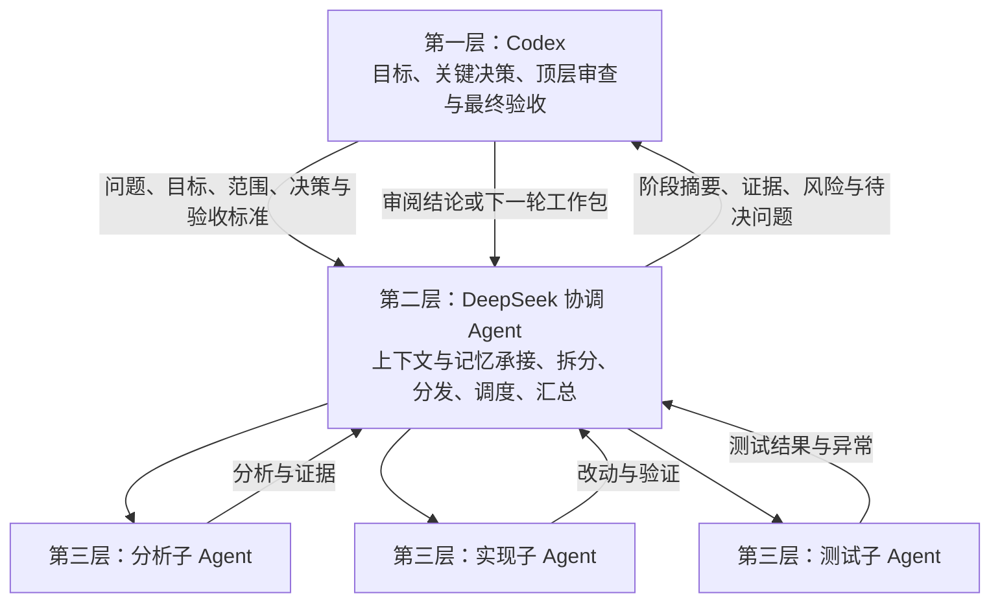

# Codex → DeepSeek 协调层 → 执行子 Agent：三层协作协议

记录日期：2026-10-19（Asia/Shanghai）

## 用户确认的结构

Codex 发现问题、分析需求和制定顶层目标，将一个有边界的工作包交给一个 DeepSeek Agent。这个 DeepSeek 作为中间协调层，承接上下文和阶段记忆，再启动、管理下层 Agent 进行分析、实现与测试，汇总结果后交回 Codex 审查。

**这份协议替代此前“DeepSeek 执行端一律不能继续创建子 Agent”的两层设计。** 允许中间层委派下层执行任务，但不无限递归。



## 三层职责

| 层级 | 职责 | 不能替代的决定 |
|---|---|---|
| 顶层 Codex | 确定问题和验收目标；给出授权边界；决定关键架构与方案取舍；独立核对改动和证据；最终验收 | 不将中间层汇总直接当作已验收，不要求用户逐条转述常规结果 |
| 中间 DeepSeek | 维护当前工作包的上下文；承接阶段记忆；拆分有界子任务；创建和调度下层 Agent；处理常规依赖与重试判断；汇总结果、异常与未完成项 | 不擅改顶层目标、被撤回方案、权限、产物基线和最终验收标准 |
| 下层执行 Agent | 按任务类型进行只读分析、指定范围实现或具体测试；返回实际动作与证据 | 不自行创建第四层 Agent，不扩大范围、不替 Codex 宣布整个问题解决 |

中间层在顶层已授权的工作包内可以自主拆分、分发和汇总，不必为每个常规子步骤向 Codex 或用户重复申请。遇到方案冲突、需要扩大范围、改变安全策略或基线时，先回到 Codex 决定；只有确实需要用户授权或业务取舍时才由 Codex 询问用户。

## 一轮实际工作流程

1. Codex 读取项目记录，明确当前问题、已有证据、已撤回方案和验收标准。
2. Codex 将一个工作包交给一个 DeepSeek 协调 Agent，带上工作目录、版本/产物、允许操作和禁止事项。
3. DeepSeek 先整理当前阶段上下文，建立子任务及依赖，再按需要启动分析、实现、测试子 Agent。
4. 独立只读任务可并行；修改同一文件、操作同一块板卡、串口或烧录器的任务应串行或持有独占资源。
5. 下层 Agent 返回结果，DeepSeek 核对完整性、整理证据，明确通过、失败、未测和替代测试条件。
6. DeepSeek 向 Codex 返回阶段摘要、变更、验证结果、异常与待决问题。子任务全部返回不等于顶层任务验收通过。
7. Codex 独立复核实际 diff、关键日志、测试与产物，决定验收、补测、修改方案或下发下一修订。
8. 同一个工作包尽量沿用同一个 DeepSeek 协调会话，保留记忆；需要隔离目标、权限或上下文时再创建新的协调会话。

## 中间层承接什么记忆

DeepSeek 协调层保存的是可核查的工作状态，不是原始推理过程：

- 当前目标、工作包 ID 与修订、来源 Codex 任务。
- 当前方案、关键决定、撤回方案及原因。
- 项目目录、源码 commit、未提交改动摘要、构建配置与镜像/产物标识。
- 子任务清单、子 Agent ID、依赖、运行状态和资源占用。
- 已确认事实、未证实假设、已排除路径。
- 每轮测试条件、实际覆盖、证据位置、异常顺序和残余风险。
- 下一步建议，以及必须回到 Codex 决定的事项。

协调会话发生压缩、恢复或更换时，应从持久化阶段摘要恢复这些状态，不凭模糊的“最新版”“之前验证过”继续执行。密钥、Cookie、私有登录 URL 和原始模型推理不得写入记忆文档。

## Markdown 的维护方式

- `DEEPSEEK_PROJECT.md`：顶层项目规划、Bug、当前决定、完成度和验收结果，以 Codex 审查后的记录为准。中间层可以提交更新建议，但不自行改写顶层验收结论。
- `DEEPSEEK_COORDINATION.md`：中间 DeepSeek 的阶段摘要、子任务分配、依赖、证据索引、异常和交接记录。Codex 可以读取和核查。
- 下层执行 Agent 返回各自结果与证据；不争抢更新顶层规划。需要写协调文档时由中间层统一合并。

上述第二个文件已由v0.8桥接自动维护：任务回执和project_collect更新记录，下一修订读取同一工作包的阶段记忆；没有后台持续写入。

建议协调记录结构：

```markdown
# 工作包 ID / 修订
## 顶层目标与验收标准
## Codex 当前决定与撤回方案
## 当前目录与源码/产物基线
## 阶段记忆：事实、假设、排除项
## 子任务与 Agent 对应表
## 资源占用与依赖
## 各子任务结果和证据
## 异常、未覆盖与待决问题
## 返回 Codex 的阶段摘要
```

## 分发与回传的最小字段

| 方向 | 必需内容 |
|---|---|
| Codex → DeepSeek 协调层 | 工作包 ID/修订、问题背景、目标、真实目录、方案与约束、版本/产物、允许的子任务类型、权限与资源范围、验收标准 |
| DeepSeek → 下层 Agent | 子任务 ID、父工作包 ID、具体角色、输入上下文、允许文件/设备操作、禁止事项、检查方法、回传要求 |
| 下层 Agent → DeepSeek | 实际动作、文件改动、产物版本、逐项结果、日志/测试证据、首异常顺序、剩余问题、资源释放状态 |
| DeepSeek → Codex | 本轮摘要、子任务汇总、与原计划的偏差、可核查证据、失败/未测项、需要顶层决定的问题 |

## 边界与异常处理

1. 只有第二层协调 Agent 可以创建第三层执行 Agent；第三层不继续委派，不形成无限递归。
2. 子任务权限和工作范围不得超过父工作包；三层结构本身不授予文件、网络、提交、推送或烧录权限。
3. “仅测试”子任务不得改源码、重建或替换指定镜像，也不得自行恢复 Codex 已撤回的方案。确需改变条件时，提出新修订交 Codex 决定。
4. 结果不确定时先查询已有会话或运行状态，禁止重复提交；停止请求必须确认终态，才能把设备资源交给下一任务。
5. 同一文件及同一物理设备不能被多个子 Agent 争抢；中间层负责调度，Codex保留核查权。
6. 编译成功、任务执行结束、现场恢复和根因修复分别报告；最终完成由 Codex 根据证据判断。
7. Harness 未运行时，可由已获授权的顶层 Agent 使用确认过的启动器拉起并验证，不执行陌生脚本、不杀占用者、不绕过 Hook 信任。
8. 已有权限映射、目录登记与运行时沙箱限制继续适用；协调提示不是强制权限隔离或自动硬件锁。

## v0.8 程序接入

project_dispatch默认role=coordinator，使用Harness原生subagent，必须产生真实worker；role=worker保留显式叶子执行。
桥接把协调摘要、任务修订、实际父子ID和结果保存到DEEPSEEK_COORDINATION.md，下轮读入同工作包记忆；project_coordination读取，project_collect刷新。
原生目录和worker turn完成状态独立核验；伪造ID、第四层、无法观察或未完成worker不会被当成三层成功。任务范围和角色仍是提示及审计约束，不宣称强制角色隔离。

# 三层Agent协作协议（替代旧版两层禁止委派规则）

默认结构：Codex顶层审查 → DeepSeek协调层 → 分析/实现/测试worker。
Codex负责目标、顶层方案、授权边界和最终验收；DeepSeek协调层承接阶段记忆，拆分有界子任务，使用Harness原生subagent创建第三层，调度并汇总。worker执行具体任务，不创建第四层。

1. 开始先读取/初始化DEEPSEEK_PROJECT.md；下发project_dispatch默认role=coordinator，需Harness。明确cwd、task_kind、allowed_files、constraints、baseline、checks和decision。中间层在授权范围内自行拆分，不逐步让用户转述。
2. 协调层必须真实调用原生subagent并等待worker结果；不能用自行执行或虚构ID冒充三层。每个worker收到完整目标、父工作包/修订、类型、版本、范围和证据要求。默认最多每轮4个，可配置1–8个。
3. 只有协调层可以分发；worker禁止继续委派。调用方明确role=worker时是叶子模式，可用于direct执行。协调模式不静默降级为direct或单Agent。
4. 调查任务只读；仅测试不修改代码/重建/换镜像/恢复已撤回方案；实现仅改允许文件。中间层及worker都不改顶层规划、AGENTS、验收标准或安全策略。冲突交Codex决定，没回复不是同意。
5. 同文件写入或同板卡/串口/烧录资源串行。停止要核对终态，不重复含糊提交。提交/推送/烧录遵守用户实际授权，不因已有示例就获得权限。
6. 协调层按格式返回阶段摘要和真实worker ID、逐项PASS/FAIL/BLOCKED/NOT_RUN/SUBSTITUTED、证据、异常顺序、风险和下一步。桥接从原生父子目录独立核验，未完成、未知子任务或第四层会阻塞验收。
7. DEEPSEEK_COORDINATION.md保存各修订的协调记忆、子任务关联与报告，由桥接维护。下次同工作包分发带入相关记忆，避免复制全部历史；用户/协调层摘要不是新授权，不能覆盖Codex当前决定。用project_coordination读取，用project_collect刷新。
8. DEEPSEEK_PROJECT.md仍由Codex维护顶层规划、Bug、决定、撤回方案、进度和最终证据。协调层报告成功只进入review，Codex独立核对diff、关键原始日志或测试后才done。
9. 同一工作包优先沿用同一空闲协调会话；角色切换需显式reuse_session=false，隔离旧角色约束。程序保存修订与历史，旧结果不能覆盖新修订。
10. MCP提示不是强制沙箱或可信角色认证，实际目录/权限仍由配置和运行时控制。原生Host深度限制才是递归的运行时守卫；桥接发现第四层则记录异常，不能声称已阻止它创建。
11. 可不填HTML，由Codex按授权识别配置；Harness未运行时只在用户已有启动授权且启动器确认后拉起，不杀端口占用者，不绕过Hook信任。当前项目登记仍需受信任Hook，不自动扩大目录白名单。
12. 不记录密钥、Cookie、私有登录URL或原始推理。用户明确指定工具、模型、禁止委派或变更范围时，以用户为准。配置/服务不可用如实记录，不伪造完成。


## v0.9 验证范围与证据交接

参见 [TASK-HANDOFF.md](TASK-HANDOFF.md)：结构化验证计划、证据目录、有界摘要和会话恢复。保留三层；不测试/仅记录方法为 NOT_RUN，最终仍由 Codex 验收。
